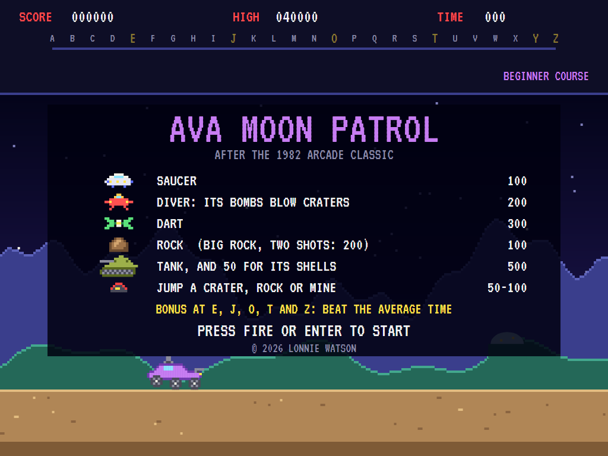
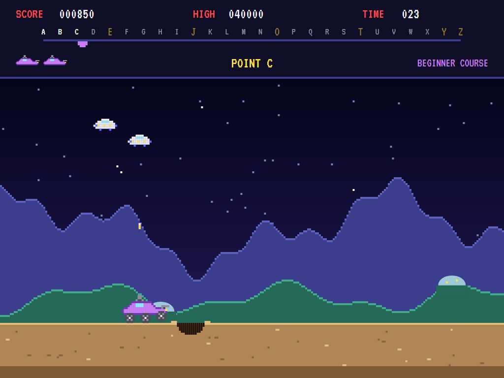
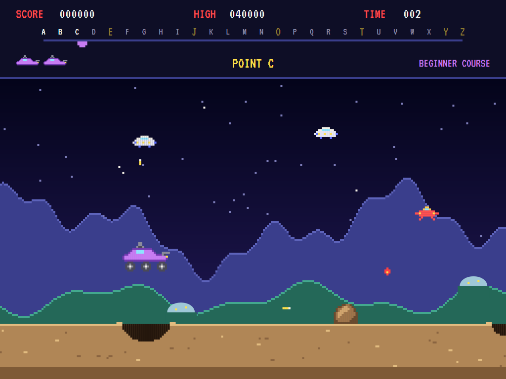
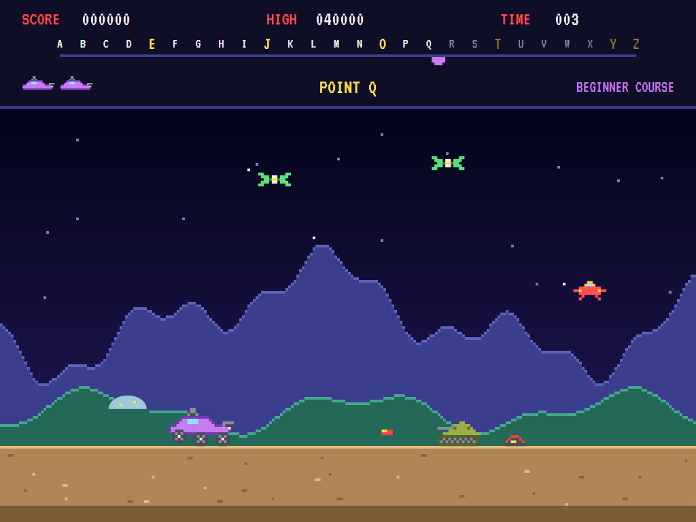
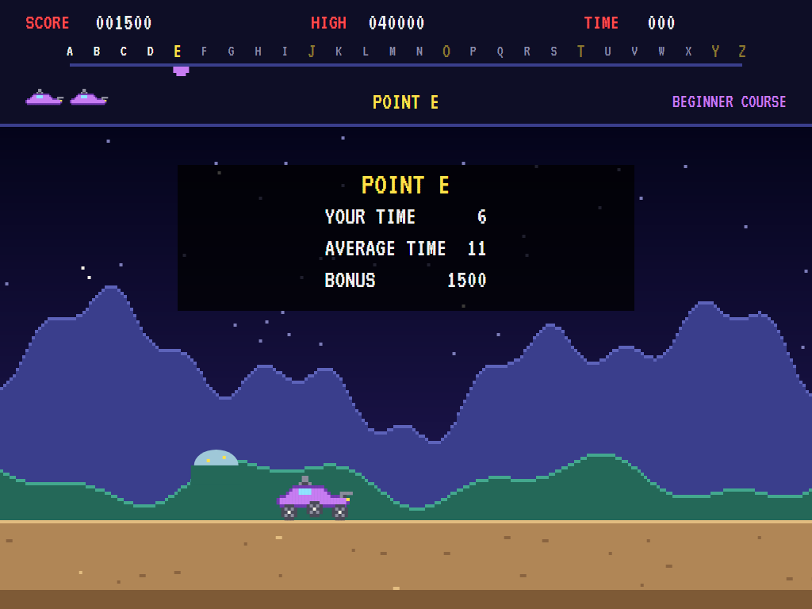
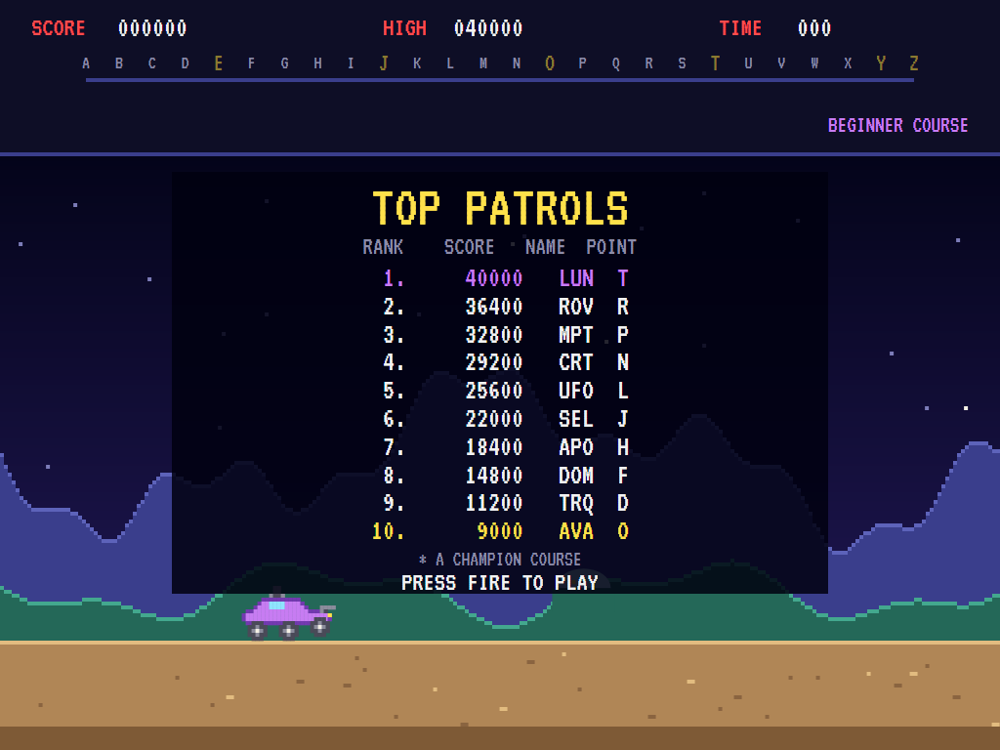

# AVAMoonPatrol

[](https://github.com/Harlock123/AVAMoonPatrol/actions/workflows/build.yml)

A lunar patrol game in the style of Irem's 1982 arcade game **Moon Patrol**, built with .NET 10 and
Avalonia UI. Drive a six-wheeled moon buggy from checkpoint A to Z across a cratered surface under
scrolling mountains. Jump the craters and mines, blast the rocks and tanks with the forward cannon, and
shoot down the saucers overhead with the upward one. Both cannons fire at once. Beat the average time
to each major checkpoint for a bonus.

## Features

- **The buggy**: speed up and it rolls ahead on the screen, slow down and it drops back; jump, and
  it sails on at the speed it took off at. The wheels bob over the ground and hang down in the air.
- **Two cannons, one button**: the forward cannon (one shot, short range) breaks rocks and stops tanks
  and their shells; the upward cannon (three shots) brings down whatever flies, bombs included.
- **The road**: **craters** to jump; **rocks** to jump or shoot, with **big rocks** that take two shots;
  **mines** that can only be jumped; and **tanks** that fire shells along the ground. Jumping anything
  scores 50 to 100 points.
- **The sky**: **saucers** loop and drop bombs; **divers** swoop low and their bombs blow **new
  craters** in the road ahead; **darts** dash back and forth and bomb fast.
- **Checkpoints A to Z** on a course bar in the panel. At **E, J, O, T and Z** you get a bonus of
  1,000 points, plus 100 for each second you beat the average time. Lose a buggy and the next one
  starts at the last checkpoint, with the road there just as it was.
- **The courses**: the **beginner course** brings in big craters and rocks, then mines from K and tanks
  from P. After Z comes the **champion course**, which starts harder and keeps getting harder.
- **Scenery**: stars, far mountains and near hills with the domes of a moon base, each scrolling at its
  own speed.
- **Music**: an original bouncing bass groove plays while you drive, and there's a title tune and
  synthesised effects, all mixed by OpenAL.
- **Attract mode**: leave the title alone for 15 seconds and a computer player plays a demonstration,
  with all its sounds.
- **Three buggies**, a bonus buggy at 10,000 points and every 20,000 after, and a **top-ten
  high-score table** with arcade-style initials entry. The table records the checkpoint you reached.
- **Any window size**: the screen scales to fit, letterboxed. **Ctrl+S** saves a screenshot.
- **One self-contained executable** per platform: Windows, macOS and Linux on Intel/AMD and ARM.

All the sprites, sounds and tunes are this game's own.

## Screenshots

| Title screen | On patrol | Over a crater |
|:------------:|:---------:|:-------------:|
|  |  |  |
| What's out there and what it's worth. | Saucers overhead, a crater ahead. | In the air over a crater, with a big rock and a diver's bomb ahead. |

| Tanks and darts | The bonus at E | The high-score table |
|:---------------:|:--------------:|:--------------------:|
|  |  |  |
| Point Q: a tank's shell coming, a mine behind it. | Six seconds against an average of eleven. | The new entry flashes in the table. |

The screenshots are made by the tests, which play the game in a real (headless) window; see
[Tests](#tests).

## Download and run

Ready-to-run builds for Windows, macOS and Linux, on both Intel/AMD and ARM, are on the
[Releases page](https://github.com/Harlock123/AVAMoonPatrol/releases/tag/latest). **Latest build** is
rebuilt on every push to `main`. Each download is one self-contained executable: no .NET install is
needed.

| Platform | Archive |
|---|---|
| Windows | `AVAMoonPatrol-win-x64.zip`, `AVAMoonPatrol-win-x86.zip`, `AVAMoonPatrol-win-arm64.zip` |
| macOS | `AVAMoonPatrol-osx-arm64.tar.gz` (Apple silicon), `AVAMoonPatrol-osx-x64.tar.gz` (Intel) |
| Linux | `AVAMoonPatrol-linux-x64.tar.gz`, `AVAMoonPatrol-linux-arm64.tar.gz`, `AVAMoonPatrol-linux-arm.tar.gz` |

```bash
tar -xzf AVAMoonPatrol-linux-x64.tar.gz     # or linux-arm64, linux-arm, osx-arm64, osx-x64
./AVAMoonPatrol
```

On Windows, unzip and run `AVAMoonPatrol.exe`. On macOS, if Gatekeeper refuses to open it, run
`xattr -d com.apple.quarantine AVAMoonPatrol` once. Run with `--no-audio` for silence.

**Sound** comes through OpenAL Soft, built in for every platform. In a virtual machine the game
detects it and uses a larger audio buffer, so the sound doesn't break up.

**Gamepads** use SDL2, which is bundled for Windows, macOS and Intel/AMD Linux. ARM Linux builds need it
installed; without it the mouse and keyboard still work:

```bash
sudo apt install libsdl2-dev            # Debian / Ubuntu / Raspberry Pi OS
sudo pacman -S --needed sdl2-compat     # Arch / Omarchy
```

## Controls

| Input | Action |
|-------|--------|
| **Right** / **D** | Speed up |
| **Left** / **A** | Slow down |
| **Up** / **W** / **Shift** / **X** | Jump |
| **Space** / **Ctrl** / **Z** | Fire both cannons (hold to keep firing) |
| **Left mouse button** / **right mouse button** | Fire / jump |
| **Enter** | Start a game |
| **P** / **Esc** | Pause (Esc again to quit) |
| **M** | Mute |
| **Ctrl+S** / **Cmd+S** | Save a screenshot to the Pictures folder |

**Gamepad**: the left stick or D-pad changes speed (up jumps too), **A** jumps, **B**, **X** or the right
trigger fires, **Start** starts and pauses, **Back** (while paused) quits.

**Entering initials**: type letters, or dial with **Up**/**Down** and accept with **Space**; **Left** /
**Backspace** go back; **Enter** finishes.

## Scoring

| Target | Points |
|---|---:|
| Saucer | 100 |
| Diver | 200 |
| Dart | 300 |
| Rock / big rock (two shots) | 100 / 200 |
| Tank / its shell | 500 / 50 |
| Jumping a small crater | 50 |
| Jumping a big crater or a rock | 80 |
| Jumping a big rock or a mine | 100 |
| Checkpoint E, J, O, T or Z | 1,000 + 100 a second under the average time |

## Tests

```bash
dotnet test AVAMoonPatrol.slnx
```

The engine has no UI and runs in fixed 60 Hz steps, so it plays the same at any frame rate, and a seed
always plays the same game. The tests check:

- speed and the buggy's place on the screen, and the jump's arc (no jumping in mid-air);
- falling into craters, jump points for everything, rocks wrecking the buggy, and the forward cannon on
  rocks, big rocks, tanks and shells (but not mines);
- the upward cannon on what flies, bombs, and the divers' new craters;
- the course: laid out the same every time, spaced to be jumpable, and hazards arriving on schedule;
- the time bonus, setting a new buggy down at the last checkpoint with the road as it was, and the
  champion course after Z;
- bonus buggies, game over and the high-score table;
- the title tune, the demonstration's sound, and pausing the music;
- every sound and sprite.

A computer player (the attract-mode one) plays whole games in them and must get past point J.

The screenshot tests draw the real screen in a headless window. To refresh the README's pictures:

```bash
MOONPATROL_SHOTS=$PWD/Images dotnet test tests/AVAMoonPatrol.Tests --filter ScreenshotTests
```

## Building

```bash
dotnet build AVAMoonPatrol.slnx
dotnet run --project src/AVAMoonPatrol
```

Needs the .NET 10 SDK. The sounds are made by `tools/make_sounds.py` (standard-library Python):
`python3 tools/make_sounds.py` rewrites `src/AVAMoonPatrol/Sounds`.

## Project structure

```
AVAMoonPatrol/
├── AVAMoonPatrol.slnx
├── src/AVAMoonPatrol/
│   ├── Engine/
│   │   ├── GameEngine.cs        # States, scoring, bonus buggies, banners and music
│   │   ├── GameEngine.Play.cs   # Driving and jumping, both cannons, the road, tanks, the sky,
│   │   │                        # collisions, checkpoints and setting a new buggy down
│   │   ├── Entities.cs          # Hazards, flying things, bombs, shells and shots
│   │   ├── AttractPilot.cs      # The computer player for the demonstration (and the tests)
│   │   ├── HighScoreTable.cs, InitialsEntry.cs
│   │   ├── InputHandler.cs, ControllerManager.cs  # Keys, mouse and an SDL2 gamepad
│   │   └── SoundManager.cs      # Effects, tunes and the driving music through OpenAL
│   ├── Audio/                   # The OpenAL engine (from the author's AVABand)
│   ├── Models/                  # The screen, the course from A to Z, and the pixel art
│   ├── Views/                   # The screen: scenery, road, patrol, panel, title and tables
│   └── Sounds/                  # The synthesised effects and tunes
├── tests/AVAMoonPatrol.Tests/   # Gameplay and screenshot tests
├── tools/make_sounds.py
└── Images/                      # Screenshots
```

## About and licence

AVAMoonPatrol © 2026 Lonnie Watson, under the [MIT License](LICENSE).

*Moon Patrol* © 1982 Irem; the name belongs to its current owner. AVAMoonPatrol is an independent,
unofficial game in its style. Its sprites, sounds, tunes and code are its own; nothing is taken from the
arcade machine's program, graphics or sound. It is not affiliated with or endorsed by any rights holder.

Bundled components keep their own licences: the VT323 font (SIL Open Font License 1.1, by Peter Hull;
`src/AVAMoonPatrol/Assets/Fonts/VT323-OFL.txt`), OpenAL Soft (LGPL-2.0-or-later; loaded as a separate
library; `src/AVAMoonPatrol/Audio/native/COPYING-openal-soft.txt`), and the MIT-licensed Avalonia,
Silk.NET, NVorbis, NLayer and SDL2-CS (with SDL2 under the zlib licence).
